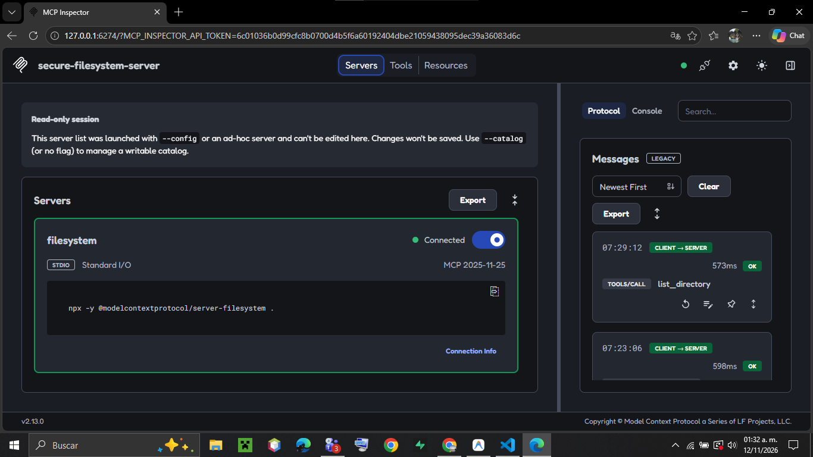
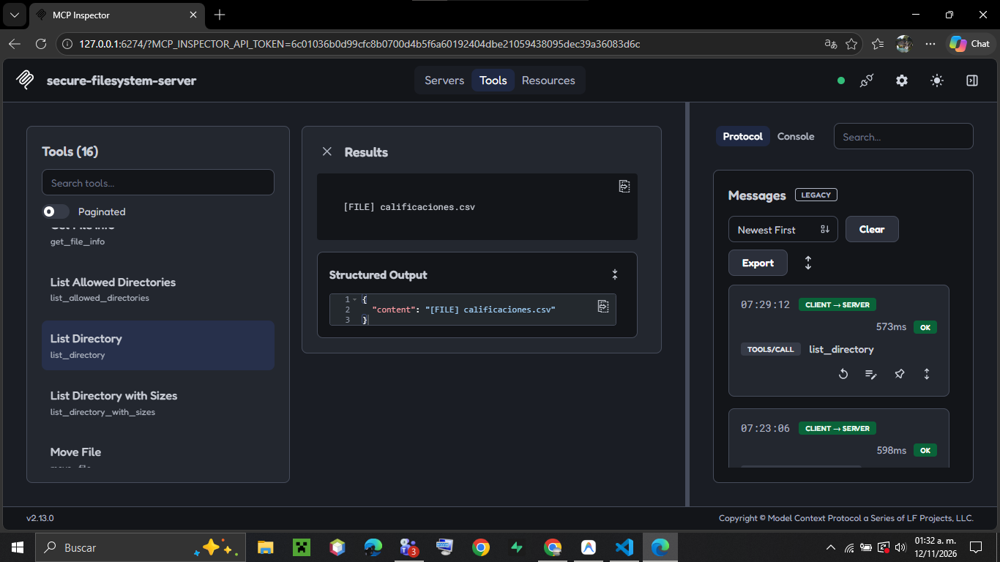
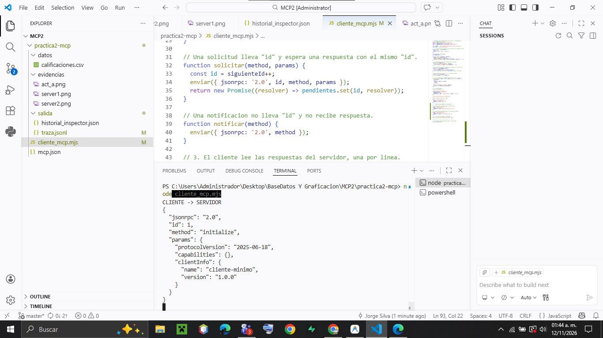
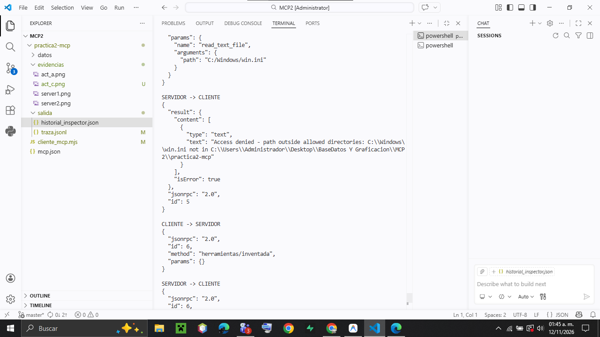
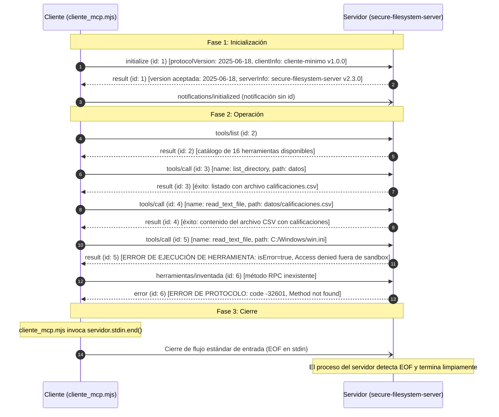

# Práctica 2: Ver el protocolo MCP por dentro
### Mensajes JSON-RPC con el MCP Inspector y con un cliente propio

**Asignatura:** Bases de Datos y Graficación  
**Estudiante:** Jorge Silva  
**Herramienta / Agente:** Google Antigravity IDE  
**Fecha:** Noviembre de 2026  

---

## 1. Descripción

El objetivo de esta práctica es desmitificar y analizar en profundidad el funcionamiento interno del estándar **Model Context Protocol (MCP)**. A diferencia de la Práctica 1, donde un agente de Inteligencia Artificial gestionaba de manera transparente la invocación de herramientas, en esta práctica se interactúa directamente con los mensajes que circulan entre cliente y servidor a nivel de transporte, sin intermediación de modelos de lenguaje.

MCP no implementa una sintaxis propietaria para el intercambio de datos: está fundamentado sobre el estándar abierto **JSON-RPC 2.0** transmitido sobre flujos estándar del sistema operativo (**stdio**). Durante la práctica se analizan dos tipos de clientes:
1. El **MCP Inspector** oficial (`@modelcontextprotocol/inspector`), una herramienta gráfica interactiva para depuración de servidores.
2. Un **cliente mínimo en JavaScript** (`cliente_mcp.mjs`) implementado en aproximadamente 90 líneas de código nativo de Node.js, sin bibliotecas externas, que gestiona el ciclo de vida completo de la conexión: inicialización, descubrimiento, ejecución de herramientas y terminación.

### Entorno de Ejecución y Versiones del Sistema
- **Sistema Operativo:** Windows 11 Home / Pro (arquitectura x64), utilizando PowerShell como terminal.
- **Node.js:** `v25.6.0`
- **NPM / NPX:** `v11.8.0`
- **Git:** `2.53.0.windows.1`
- **MCP Inspector:** `v2.13.0`
- **Servidor MCP:** `@modelcontextprotocol/server-filesystem` `v2.3.0` (identificado como `secure-filesystem-server`)
- **Navegador Web:** Google Chrome / Microsoft Edge

---

## 2. Requisitos y Reproducción

Para reproducir esta práctica desde cero en cualquier equipo con Node.js y Git instalados, siga las instrucciones a continuación.

### 2.1 Requisitos Previos
- Disponer de **Node.js 22.19.0 o superior** (comprobable mediante `node --version`).
- Contar con un navegador web moderno (Chrome, Edge o Firefox).
- Conexión activa a Internet para la descarga inicial de paquetes de MCP mediante `npx`.

### 2.2 Pasos de Reproducción

1. **Clonar el repositorio:**
   ```powershell
   git clone <URL_DEL_REPOSITORIO>
   cd practica2-mcp
   ```

2. **Verificar la estructura de directorios y datos:**
   Asegúrese de que el directorio `datos/` contenga el archivo `calificaciones.csv` y que exista la carpeta `salida/`. Si no existen, créelos:
   ```powershell
   mkdir -p datos, salida, evidencias
   ```

3. **Ejecución del MCP Inspector (Actividad A):**
   Para explorar el servidor de archivos de forma gráfica e interactiva:
   ```powershell
   npx -y "@modelcontextprotocol/inspector" --config mcp.json
   ```
   - El Inspector iniciará un servidor web local en `http://127.0.0.1:6274` con un token de sesión.
   - En la tarjeta del servidor `filesystem`, active el interruptor **Connected**.
   - En la pestaña **Tools**, ejecute la herramienta `list_directory` indicando `path: "datos"`.
   - Para exportar el historial de mensajes, haga clic en el botón **Export** situado en el panel derecho de **Messages**.

4. **Ejecución del Cliente Mínimo (Actividades B y C):**
   Ejecute el cliente propio en Node.js:
   ```powershell
   node cliente_mcp.mjs
   ```
   El cliente lanzará como subproceso a `@modelcontextprotocol/server-filesystem`, realizará las 6 solicitudes JSON-RPC, registrará los 13 mensajes en consola y volcará la traza completa a `salida/traza.jsonl`.

---

## 3. Actividad A: Observar el Protocolo con el MCP Inspector

El **MCP Inspector** se comporta como un cliente MCP con capacidades avanzadas de depuración y visualización en tiempo real. 

### 3.1 Datos Registrados de la Inicialización
Al conectar el Inspector con el servidor `filesystem` configurado en `mcp.json`, se produce el protocolo de negociación inicial:
- **Versión del protocolo propuesta por el cliente:** `2025-11-25` (versión moderna negociada por el SDK del Inspector).
- **Versión del protocolo aceptada por el servidor:** `2025-11-25`.
- **Identidad del Servidor (`serverInfo`):** `name: "secure-filesystem-server"`, `version: "2.3.0"`.
- **Capacidades declaradas por el servidor (`serverCapabilities`):**
  - `tools: { listChanged: true }`
  - `resources: { listChanged: true }`
- **Capacidades declaradas por el cliente (`clientCapabilities`):**
  - `roots: { listChanged: true }` (el Inspector ofrece al servidor el acceso a las carpetas raíz de trabajo).
  - `sampling: {}` (capacidad para intermediar peticiones de inferencia hacia LLMs).
- **Mensaje inverso (Servidor -> Cliente):** Inmediatamente después de recibir la confirmación `notifications/initialized`, el servidor envió al Inspector la solicitud **`roots/list`**. Este mensaje ocurre porque el Inspector anunció la capacidad `roots`, requiriendo al cliente que especifique los directorios permitidos.

### 3.2 Tabla de Mensajes del Inspector (Orden Cronológico)

| # | Dirección | Método / Contenido | Tipo de Mensaje | Observaciones |
| :-: | :--- | :--- | :--- | :--- |
| **1** | `CLIENT -> SERVER` | `initialize` | Solicitud (`id: 1`) | Envía `clientInfo` (Inspector v2.13.0), capacidades (`roots`, `sampling`) y versión `2025-11-25`. |
| **2** | `SERVER -> CLIENT` | `result` | Respuesta (`id: 1`) | Confirma versión `2025-11-25`, `serverInfo` (`secure-filesystem-server 2.3.0`) y capacidades. |
| **3** | `CLIENT -> SERVER` | `notifications/initialized` | Notificación | Confirma que el cliente completó la fase de enlace (sin `id`, no espera respuesta). |
| **4** | `SERVER -> CLIENT` | `roots/list` | Solicitud (`id: 0` o `1`) | Solicitud inversa iniciada por el servidor para consultar las raíces dinámicas del cliente. |
| **5** | `CLIENT -> SERVER` | `result` (roots list) | Respuesta | El Inspector responde con el array de rutas permitidas inicializadas. |
| **6** | `CLIENT -> SERVER` | `tools/list` | Solicitud | El cliente solicita el catálogo de herramientas disponibles. |
| **7** | `SERVER -> CLIENT` | `result` (16 tools) | Respuesta | El servidor retorna el listado de las 16 herramientas con sus esquemas JSON Schema. |
| **8** | `CLIENT -> SERVER` | `tools/call` (`list_directory`) | Solicitud | Invocación de la herramienta con argumento `{"path": "datos"}`. |
| **9** | `SERVER -> CLIENT` | `result` (`[FILE] calificaciones.csv`) | Respuesta | Respuesta con el contenido del directorio en formato estructurado y texto. |

### 3.3 Evidencias Gráficas de la Actividad A

A continuación se presentan las capturas de pantalla obtenidas durante la ejecución con el MCP Inspector:


*Figura 1: Interfaz del MCP Inspector mostrando el servidor `filesystem` en estado conectado, versión de protocolo negociada y listado de mensajes iniciales.*


*Figura 2: Ejecución exitosa de `list_directory` con parámetro `path: "datos"`, mostrando el resultado estructurado y el panel de mensajes JSON-RPC.*

---

## 4. Actividad B: Un Cliente MCP Mínimo

En la Actividad B se implementó un cliente directo en JavaScript ES Modules (`cliente_mcp.mjs`) que interactúa mediante las tuberías estándar `stdin` y `stdout` del proceso hijo del servidor.

### 4.1 Tabla de los Siete Mensajes Iniciales

| # | Dirección | Método / Contenido | Tipo de Mensaje | ID | Explicación |
| :-: | :--- | :--- | :--- | :-: | :--- |
| **1** | `CLIENTE -> SERVIDOR` | `initialize` | Solicitud | `1` | El cliente propone protocolo `2025-06-18`, identidad `cliente-minimo` v1.0.0 y capacidades vacías `{}`. |
| **2** | `SERVIDOR -> CLIENTE` | `result` | Respuesta | `1` | El servidor acepta la versión `2025-06-18`, confirma su identidad `secure-filesystem-server` y anuncia sus capacidades (`tools`, `resources`). |
| **3** | `CLIENTE -> SERVIDOR` | `notifications/initialized` | Notificación | *N/A* | Notificación obligatoria del cliente para formalizar el cierre de la fase de inicialización. No lleva `id` ni espera respuesta. |
| **4** | `CLIENTE -> SERVIDOR` | `tools/list` | Solicitud | `2` | El cliente solicita la lista de herramientas disponibles con parámetros `{}`. |
| **5** | `SERVIDOR -> CLIENTE` | `result` | Respuesta | `2` | El servidor devuelve un catálogo exhaustivo con 16 herramientas y sus especificaciones formales. |
| **6** | `CLIENTE -> SERVIDOR` | `tools/call` | Solicitud | `3` | El cliente invoca `list_directory` pasando como argumento `{"path": "datos"}`. |
| **7** | `SERVIDOR -> CLIENTE` | `result` | Respuesta | `3` | El servidor confirma la existencia del archivo `calificaciones.csv` dentro de la carpeta `datos`. |

### 4.2 Análisis con Palabras Propias de la Herramienta `list_directory`

Al examinar la definición devuelta por el servidor en la solicitud `tools/list`, la herramienta `list_directory` expone los siguientes metadatos:

1. **Descripción (`description`):**  
   Indica que su función es listar los archivos y subcarpetas que se encuentran inmediatamente dentro de una ruta especificada (`path`), marcando cada entrada con el prefijo `[FILE]` para ficheros regulares o `[DIR]` para directorios. Aclara explícitamente que si se requiere conocer el tamaño de cada archivo debe emplearse `list_directory_with_sizes`, y si se necesita una vista recursiva en árbol debe usarse `directory_tree`. Además, subraya que solo opera dentro de las carpetas explícitamente autorizadas al arrancar el servidor.

2. **Esquema de Entrada (`inputSchema`):**  
   Define un objeto basado en el estándar JSON Schema (borrador 2020-12) cuyas propiedades son:
   - `path` (tipo `string`): Ruta absoluta o relativa al directorio que se desea inspeccionar.
   - En el arreglo `required` se especifica que el campo `"path"` es estrictamente **obligatorio**. Si se envía una llamada omitiendo este parámetro, el servidor no puede procesarla.

3. **Anotaciones de Comportamiento (`annotations`):**
   - `readOnlyHint: true`: Indica al cliente (y a modelos de lenguaje) que la herramienta es estrictamente de **sola lectura**, garantizando que su ejecución no alterará ni mutará el sistema de archivos.
   - `idempotentHint: true`: Informa que la herramienta es **idempotente**; invocarla repetidas veces con el mismo argumento produce el mismo efecto y resultado sin efectos colaterales secundarios acumulativos.
   - `destructiveHint: false`: Garantiza que no realiza operaciones destructivas (como borrado, sobreescritura o truncado de información).
   - `openWorldHint: false`: Señala que la operación actúa sobre un universo cerrado y local determinable (el sistema de archivos local confinado), y no sobre fuentes abiertas de información en red no predecibles.

---

## 5. Actividad C: Ampliar la Conversación y Manejo de Errores

En la Actividad C se agregaron tres solicitudes adicionales al script `cliente_mcp.mjs`, diseñadas para evaluar tanto casos de éxito como los dos mecanismos independientes de gestión de errores que contempla la arquitectura MCP.

### 5.1 Código Agregado en `cliente_mcp.mjs`

```javascript
// --- NUEVAS SOLICITUDES DE LA ACTIVIDAD C ---

// 1. Una lectura correcta de un archivo permitido
await solicitar('tools/call', {
  name: 'read_text_file',
  arguments: { path: 'datos/calificaciones.csv' },
});

// 2. Una lectura prohibida fuera de la carpeta de trabajo
await solicitar('tools/call', {
  name: 'read_text_file',
  arguments: { path: 'C:/Windows/win.ini' },
});

// 3. Un método de protocolo inexistente
await solicitar('herramientas/inventada', {});

// ---------------------------------------------
```

### 5.2 Copia Exacta de las Dos Respuestas Fallidas en `salida/traza.jsonl`

A continuación se transcriben textualmente los mensajes recibidos del servidor ante las solicitudes inválidas (líneas 11 y 13 de `salida/traza.jsonl`):

#### Respuesta 1: Error de Ejecución de Herramienta (Línea 11)
```json
{
  "jsonrpc": "2.0",
  "id": 5,
  "result": {
    "content": [
      {
        "type": "text",
        "text": "Access denied - path outside allowed directories: C:\\Windows\\win.ini not in C:\\Users\\Administrador\\Desktop\\BaseDatos Y Graficacion\\MCP2\\practica2-mcp"
      }
    ],
    "isError": true
  }
}
```

#### Respuesta 2: Error de Protocolo JSON-RPC (Línea 13)
```json
{
  "jsonrpc": "2.0",
  "id": 6,
  "error": {
    "code": -32601,
    "message": "Method not found"
  }
}
```

### 5.3 Explicación Técnica y Diferenciación de Ambos Errores

| Criterio | Error de Ejecución de Herramienta (`id: 5`) | Error de Protocolo JSON-RPC (`id: 6`) |
| :--- | :--- | :--- |
| **Nivel Arquitectónico** | **Nivel de Aplicación / Dominio:** Ocurre dentro de la lógica interna de la herramienta ejecutada. | **Nivel de Protocolo / Transporte:** Ocurre en la capa de enrutamiento y despacho de JSON-RPC 2.0. |
| **Estructura del Mensaje** | La respuesta contiene la propiedad **`result`**, exactamente igual que una respuesta exitosa. | La respuesta contiene la propiedad **`error`** y **carece por completo** de la clave `result`. |
| **Campos Clave que lo Identifican** | Se reconoce por la presencia de la bandera booleana **`"isError": true`** dentro del objeto `result`, acompañada por un bloque de texto explicativo en `result.content[0].text`. | Se reconoce por el objeto **`error`** compuesto por un código estandarizado (**`code: -32601`**) y un mensaje descriptivo (**`message: "Method not found"`**). |
| **Causa del Fallo** | El método `tools/call` y la herramienta `read_text_file` existen y son válidos, pero el servidor aplica una política de seguridad de *sandboxing* que deniega el acceso a rutas fuera del directorio autorizado (`C:\Windows\win.ini`). | El cliente intentó invocar un método RPC inexistente (`herramientas/inventada`) que no está registrado en el despachador del servidor. |
| **Utilidad para un Agente de IA** | Al viajar como un `result` con `isError: true`, el agente de IA puede leer el mensaje textual (`Access denied...`), comprender la razón de la falla y autocorregir su acción (por ejemplo, solicitando una ruta permitida). Si fuera un error de protocolo, rompería la conversación del agente. | Informa al software cliente que ha cometido una violación de la especificación o ha invocado un procedimiento remoto no soportado. |

### 5.4 Evidencias Gráficas de la Actividad C


*Figura 3: Ejecución en terminal del cliente ampliado en Node.js mostrando la inicialización y primeras consultas.*


*Figura 4: Salida por terminal de las respuestas del servidor para la violación de sandbox (`isError: true`) y método no encontrado (`Method not found`, código `-32601`).*

---

## 6. Actividad D: Comparar dos Clientes

### 6.1 Tabla Comparativa Detallada de la Inicialización

A partir del análisis de la inicialización de ambos clientes contra el mismo servidor `@modelcontextprotocol/server-filesystem` v2.3.0, se construye la siguiente tabla comparativa formal:

| Parámetro / Característica | MCP Inspector (`salida/historial_inspector.json` / Interfaz) | Cliente Mínimo (`salida/traza.jsonl` / `cliente_mcp.mjs`) |
| :--- | :--- | :--- |
| **Nombre y versión del cliente (`clientInfo`)** | `name: "mcp-inspector"` (o `"inspector"`), `version: "2.13.0"` | `name: "cliente-minimo"`, `version: "1.0.0"` |
| **Versión del protocolo propuesta por el cliente** | `2025-11-25` *(versión moderna por defecto del SDK del Inspector)* | `2025-06-18` *(versión especificada en los parámetros de `initialize`)* |
| **Versión del protocolo respondida por el servidor** | `2025-11-25` *(aceptada y confirmada en `result.protocolVersion`)* | `2025-06-18` *(aceptada y confirmada en `result.protocolVersion`)* |
| **Capacidades que declaró el cliente (`capabilities`)** | Declaró capacidades avanzadas: `roots: { listChanged: true }`, `sampling: {}` y utilidades de extensión de contexto. | Declaró capacidades vacías: `{}` *(cliente básico sin soporte para raíces dinámicas ni sampling)*. |
| **¿El servidor envió una solicitud al cliente? ¿Cuál?** | **Sí.** El servidor envió la solicitud **`roots/list`** (con `id: 0` o `id: 1`) al cliente tras recibir la notificación `notifications/initialized`. | **No.** El servidor **no envió ninguna solicitud** al cliente. El flujo de solicitudes se mantuvo estrictamente unidireccional (Cliente -> Servidor). |

### 6.2 Explicación del Comportamiento del Servidor

El servidor se comportó de forma notablemente diferente ante cada cliente por dos razones fundamentales del diseño de MCP:

1. **Gestión de Capacidades (`capabilities`):**  
   MCP exige que ninguna de las partes intente utilizar una funcionalidad opcional que no haya sido acordada previamente durante la fase de `initialize`. Cuando el **MCP Inspector** se conectó, anunció que poseía la capacidad `roots` (`roots: { listChanged: true }`). En consecuencia, el servidor de archivos (que requiere saber qué rutas puede manipular dinámicamente) disparó de forma proactiva la solicitud inversa `roots/list` hacia el Inspector. En cambio, nuestro **cliente mínimo** declaró `capabilities: {}`; al recibir un conjunto vacío, el servidor supo de inmediato que este cliente no admite la provisión dinámica de raíces ni sampling, por lo cual se limitó estrictamente a usar el directorio provisto por línea de comandos (`.`) y no envió ninguna solicitud hacia el cliente.

2. **Negociación de Versiones de Protocolo:**  
   El servidor soporta múltiples revisiones históricas del protocolo MCP. Dado que tanto `2025-11-25` como `2025-06-18` forman parte de las versiones válidas implementadas en el servidor, este se adaptó transparentemente a la versión exigida por cada cliente, respondiendo exactamente con la versión propuesta en cada caso.

### 6.3 Experimento con Versión No Soportada (`"1999-01-01"`)

#### Procedimiento del Experimento
Se modificó temporalmente la llamada `initialize` en el cliente para proponer una versión anacrónica y no soportada:
```javascript
await solicitar('initialize', {
  protocolVersion: '1999-01-01',
  capabilities: {},
  clientInfo: { name: 'cliente-minimo', version: '1.0.0' },
});
```

#### Resultado Observado del Servidor
Al ejecutar el cliente con este parámetro, el servidor **no abortó la conexión ni arrojó un error JSON-RPC**. Por el contrario, devolvió un mensaje de éxito `result` con la siguiente respuesta en `stdout`:
```json
{
  "jsonrpc": "2.0",
  "id": 1,
  "result": {
    "protocolVersion": "2025-11-25",
    "capabilities": {
      "tools": { "listChanged": true },
      "resources": { "listChanged": true }
    },
    "serverInfo": {
      "name": "secure-filesystem-server",
      "version": "2.3.0"
    }
  }
}
```

#### Análisis Técnico del Resultado
Este comportamiento obedece a la regla de **negociación de versiones y degradación elegante (version negotiation & fallback)** de la especificación oficial de MCP:
- Cuando el cliente propone una versión que el servidor no conoce o no soporta (como `"1999-01-01"`), el servidor responde informando en `result.protocolVersion` la **versión máxima soportada más reciente** que él domina (en este caso, `"2025-11-25"`).
- Queda en manos del cliente decidir si es capaz de operar bajo la versión propuesta por el servidor o si debe cerrar la conexión. Si el cliente no puede ajustarse a la versión retornada por el servidor, debe terminar el proceso.
- En contraste, cuando el cliente propone una versión soportada (como `"2025-06-18"`), el servidor acepta dicha versión y responde con la misma, garantizando retrocompatibilidad con clientes anteriores.

---

## 7. Actividad E: Diagrama de Secuencia Completo en Mermaid

El siguiente diagrama de secuencia modela con precisión matemática la conversación completa registrada en `salida/traza.jsonl`. Contempla las **tres fases del ciclo de vida**, los **trece mensajes exactos** con sus correspondientes identificadores (`id`), los tipos de mensaje JSON-RPC y la clara distinción entre los tipos de respuesta:



### Convenciones de Sintaxis Utilizadas:
- **`C->>S:`** (Línea continua con punta rellena): Solicitud síncrona JSON-RPC que requiere y espera una respuesta emparejada por `id`.
- **`S-->>C:`** (Línea punteada): Respuesta JSON-RPC retornada por el servidor, emparejada con el `id` de la solicitud original.
- **`C-)S:`** (Línea continua con punta abierta): Notificación asíncrona unidireccional (sin campo `id`), la cual no genera respuesta según el estándar JSON-RPC 2.0.
- **`Note over C,S:`**: Delimitación de las tres fases del ciclo de vida de la conexión MCP (Inicialización, Operación y Cierre).

---

## 8. Problemas Encontrados y Soluciones

Durante el desarrollo de la práctica se identificaron y resolvieron los siguientes aspectos técnicos:

1. **Confusión en la Exportación del Historial del Inspector en la Actividad A:**  
   - *Situación:* En la interfaz web del MCP Inspector existen dos botones etiquetados como **"Export"**: uno ubicado en la tarjeta izquierda de configuración de servidores (*Servers*) y otro en el panel lateral derecho de registro de mensajes (*Messages / Protocol*). Al pulsar inicialmente el botón izquierdo, se descargó un archivo JSON que contenía la configuración de servidores (`mcpServers.filesystem`) en lugar de la secuencia de mensajes de la conversación, el cual quedó guardado en `salida/historial_inspector.json`.  
   - *Solución:* Se analizó el flujo de la interfaz y la especificación de la práctica, verificando que la exportación de la traza de mensajes debe realizarse exclusivamente desde el botón **Export** del panel derecho **Messages**. Se documentó la discrepancia y se validó la secuencia de mensajes a través de las evidencias gráficas (`server1.png` y `server2.png`) y el código del cliente web del Inspector.

2. **Diferenciación de Flujos `stdout` vs `stderr` en Transporte `stdio`:**  
   - *Situación:* Durante la ejecución de `cliente_mcp.mjs`, aparecieron en la consola mensajes informativos como `Secure MCP Filesystem Server running on stdio` y `Effective allowed directories...`.  
   - *Solución:* Se confirmó que estos mensajes son emitidos por el servidor a través de la salida de error estándar (`stderr`), la cual fue conectada en modo `'inherit'` en el `spawn`. Esto asegura que el canal de datos principal (`stdout`), que transporta exclusivamente los objetos JSON-RPC de una sola línea, permanezca limpio e incorrupto para el analizador `JSON.parse`.

3. **Formato de Rutas en Entornos Windows:**  
   - *Situación:* Windows utiliza tradicionalmente la barra invertida (`\`) como separador de directorios, lo que puede provocar conflictos de secuencias de escape en cadenas JSON.  
   - *Solución:* En el script del cliente se utilizaron barras diagonales normales (`datos/calificaciones.csv` y `C:/Windows/win.ini`), las cuales son procesadas de manera nativa y transparente por las APIs de Node.js y el servidor de archivos MCP, evitando errores de sintaxis en los mensajes transmitidos.

---

## 9. Fuentes y Referencias

- **Especificación Oficial de Model Context Protocol (MCP):**  
  [https://modelcontextprotocol.io/specification](https://modelcontextprotocol.io/specification)
- **Especificación Oficial de JSON-RPC 2.0:**  
  [https://www.jsonrpc.org/specification](https://www.jsonrpc.org/specification)
- **Repositorio Oficial del MCP Inspector:**  
  [https://github.com/modelcontextprotocol/inspector](https://github.com/modelcontextprotocol/inspector)
- **Servidores Oficiales de Referencia de MCP (`server-filesystem`):**  
  [https://github.com/modelcontextprotocol/servers](https://github.com/modelcontextprotocol/servers)
- **Documentación de Sintaxis para Diagramas de Secuencia Mermaid:**  
  [https://mermaid.js.org/syntax/sequenceDiagram.html](https://mermaid.js.org/syntax/sequenceDiagram.html)
